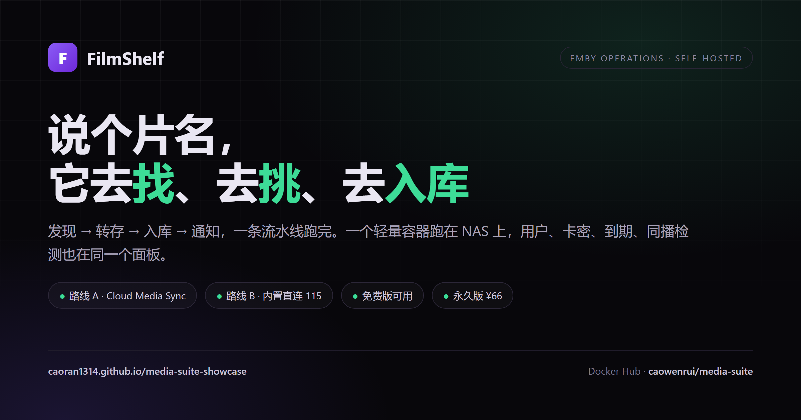
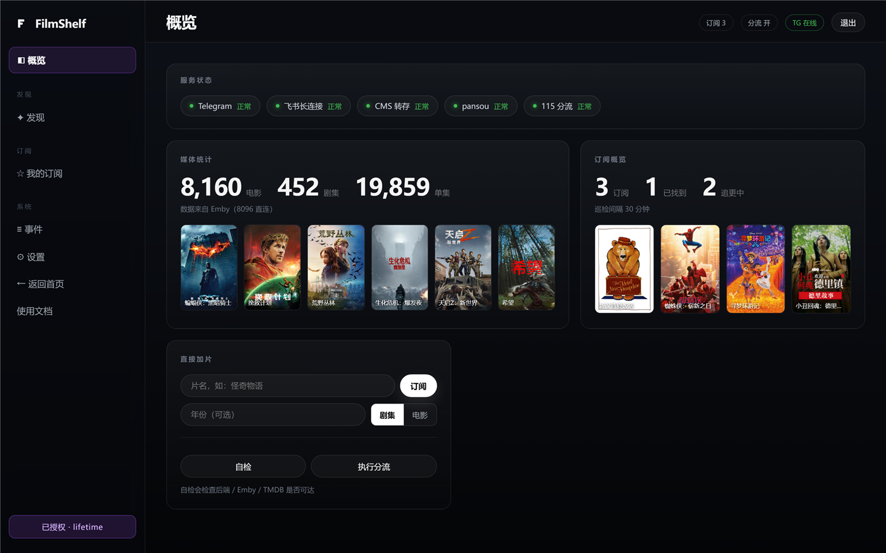
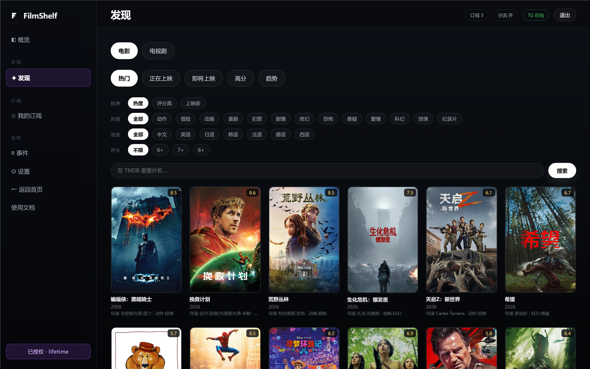
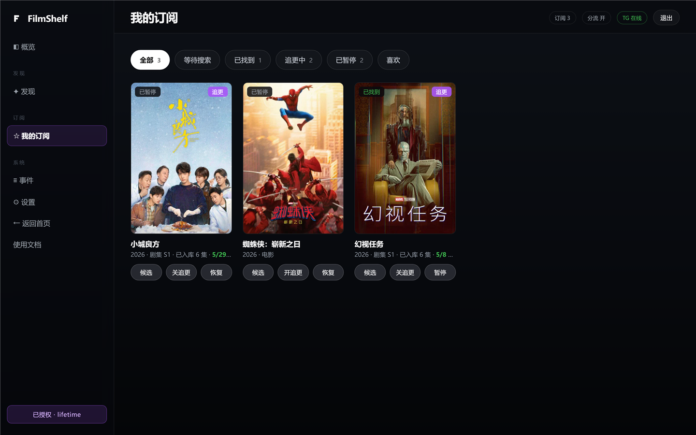
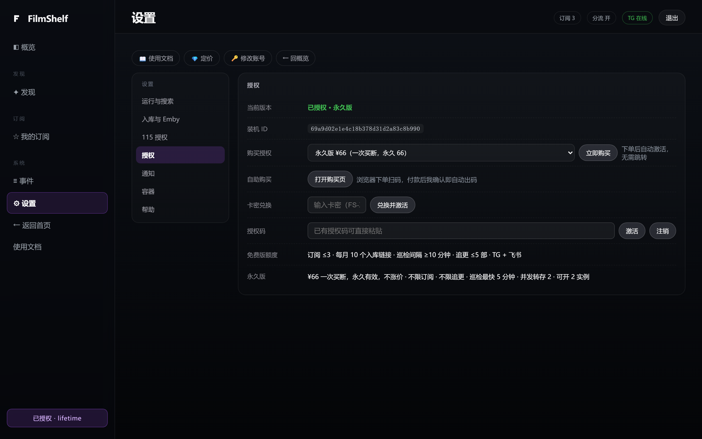
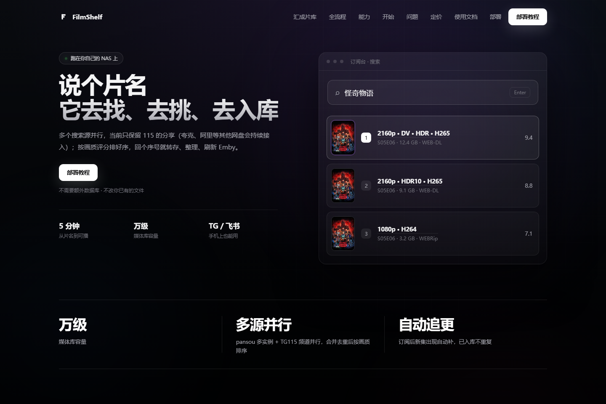
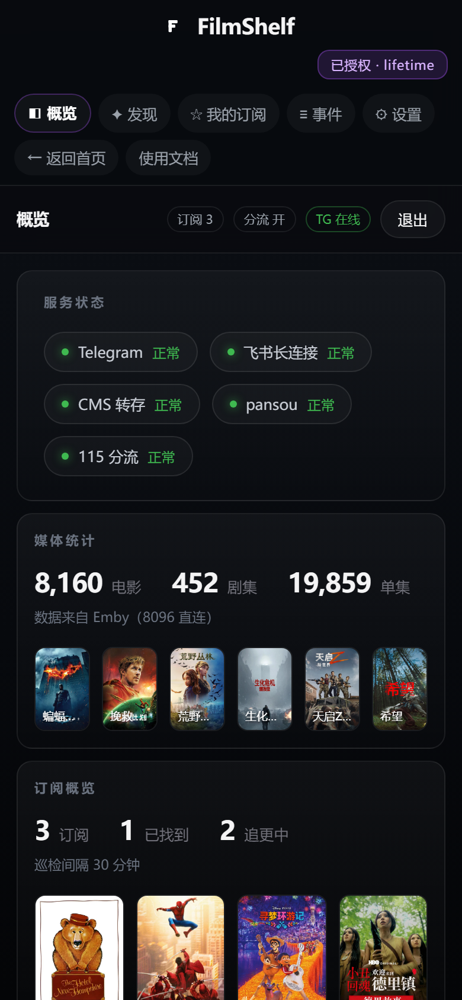

# FilmShelf · media-suite

> 自建 Emby 影音库的「发现 → 转存 → 入库 → 通知」自动化面板。
> 一个轻量容器跑在 NAS 上，把找片、追更、开号、续费这些琐事串成一条流水线。

<p align="center">
  
</p>

<p align="center">
  <a href="https://hub.docker.com/r/caowenrui/media-suite"></a>
  
  
  
</p>

---

## 它解决什么问题

自己维护 Emby 服的人，通常都在重复这些动作：

- 在群里看到片名，去搜资源，转存 115，等整理，再确认 Emby 刷出来；
- 追的剧一周一集，每次都要手动找新集；
- 朋友要开号、续费、到期提醒，全靠微信记账；
- 想看看谁在看、同时几台设备，只能进 Emby 后台翻。

media-suite 把这些动作收进一个面板：**搜到 → 一键转存 → 自动入库 → 通知你**，外加用户/卡密/到期管理。它不下载、不刮削，重活交给 Cloud Media Sync（路线 A）或内置直连 115（路线 B）。

## 界面

<p align="center">
  <br>
  <sub>概览：服务状态、媒体统计、订阅进度</sub>
</p>

<p align="center">
  
  <br>
  <sub>发现：TMDB 热门与筛选；我的订阅：海报墙、追更与候选入口</sub>
</p>

<p align="center">
  
  <br>
  <sub>影视详情与演职人员；授权页：永久版 ¥66、免费额度一目了然</sub>
</p>

<p align="center">
  <br>
  <sub>产品首页：说个片名，它去找、去挑、去入库</sub>
</p>

<p align="center">
  <br>
  <sub>手机浏览器同样可用</sub>
</p>

## 功能

| 模块 | 能做什么 |
| --- | --- |
| 发现 | TMDB 聚合热门/即将上映；搜片名直接出资源候选 |
| 订阅 | 电影/剧集订阅，自动追更，候选按评分/体积/清晰度排序 |
| 转存 | Cloud Media Sync（路线 A）或内置直连 115（路线 B） |
| 入库 | 路线 A：CMS 自动命名、生成 strm、刷新 Emby；路线 B：整理进 115（strm 需自备） |
| 用户 | Emby 开号、续期、禁用、删除、媒体库权限 |
| 卡密 | 生成/导出卡密，买家自助兑换开通 |
| 监控 | 正在播放、播放统计、同播检测（告警/踢下线） |
| 通知 | Telegram Bot + 飞书，模板可改 |

## 快速开始

```yaml
services:
  media-suite:
    image: caowenrui/media-suite:2.1.0
    container_name: media-suite
    restart: unless-stopped
    ports:
      - "8790:8790"
    volumes:
      - ./data:/data
    environment:
      TZ: Asia/Shanghai
      EMBY_URL: http://10.0.0.5:8096
      EMBY_API_KEY: your-emby-api-key
      TMDB_API_KEY: your-tmdb-api-key
```

```bash
docker compose up -d
# 打开 http://NAS_IP:8790，首次用 admin/admin 登录并改密码
```

完整参数见 [docs/ENV.md](docs/ENV.md)，部署教程见 [docs/TUTORIAL.md](docs/TUTORIAL.md)。

## 两条转存路线

- **路线 A（可选）**：Cloud Media Sync 负责转存、整理、strm、Emby 刷新，media-suite 只做调度。
- **路线 B**：不装 CMS，`TRANSFER_BACKEND=115direct` + 115 Cookie，由内置直连完成转存并整理进 115 目录；**不生成 strm**，Emby 需要自行挂载 115。完整步骤见 [docs/TUTORIAL.md](docs/TUTORIAL.md)。

115 网盘两条路线都需要；CMS 只是路线 A 的组件。

## 授权与价格

- **免费版**：订阅 ≤ 3 个、每月 10 个入库链接、追更 ≤ 5 部、巡检间隔 ≥ 10 分钟。
- **永久版**：¥66 / 台，不限订阅与入库数量。
- 授权为**商业授权**，仅限自用部署，禁止复制、转售、二次开发与反向工程；详见 [LICENSE](LICENSE)。

购买与激活入口在面板「授权」页；历史卡密继续有效。

## 文档

- [部署教程](docs/TUTORIAL.md)
- [环境变量](docs/ENV.md)
- [依赖与路线](docs/DEPENDENCIES.md)
- [更新日志](CHANGELOG.md)
- [Docker Hub](https://hub.docker.com/r/caowenrui/media-suite)

## 说明

本仓库是产品展示与文档仓库，**不包含源码**。镜像内代码经过压缩处理；源码仓库私有。
只提供资源发现与调度能力，不提供、不存储、不分发任何影视资源；请确保使用方式符合当地法规与第三方服务条款。
